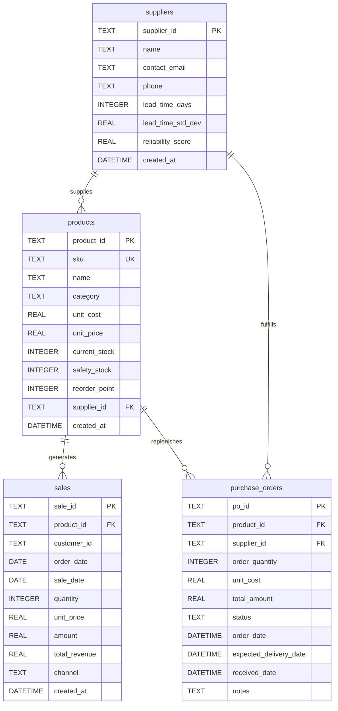

# Dynamic Inventory

[](https://react.dev/)
[](https://vitejs.dev/)
[](https://tailwindcss.com/)
[](https://nodejs.org/)
[](https://expressjs.com/)
[](https://nodejs.org/api/sqlite.html)
[](https://www.sqlite.org/wal.html)
[](#-local-multi-service-setup)
[](https://opensource.org/licenses/MIT)

> Enterprise-grade inventory optimization and demand forecasting engine delivering sub-second real-time stock tracking, atomic serialized concurrency control, and automated reorder thresholds powered by stochastic safety stock algorithms and native SQL window functions.

---

## 📑 Table of Contents
- [System Architecture](#-system-architecture)
- [Core Full-Stack Features](#-core-full-stack-features)
  - [1. Concurrency Handling & Overselling Prevention](#1-concurrency-handling--overselling-prevention)
  - [2. Real-Time Stock Level Updates & Telemetry](#2-real-time-stock-level-updates--telemetry)
  - [3. Stochastic Demand Forecasting & Reorder Point (ROP) Engine](#3-stochastic-demand-forecasting--reorder-point-rop-engine)
  - [4. Role-Based Access Control (RBAC) & Security Architecture](#4-role-based-access-control-rbac--security-architecture)
- [Database Schema & Relational Models](#-database-schema--relational-models)
  - [Entity Relationship Overview](#entity-relationship-overview)
  - [Core Entity Data Dictionary](#core-entity-data-dictionary)
  - [Advanced SQL Views & Triggers](#advanced-sql-views--triggers)
- [API Reference](#-api-reference)
- [Local Multi-Service Setup](#-local-multi-service-setup)
  - [Option A: Docker Multi-Service Setup (Containerized)](#option-a-docker-multi-service-setup-containerized)
  - [Option B: Local Native Setup (Node.js & npm)](#option-b-local-native-setup-nodejs--npm)
- [Environment Variables](#-environment-variables)
- [Verification & Automated Test Suite](#-verification--automated-test-suite)
- [License](#-license)

---

## 🏛️ System Architecture

Dynamic Inventory processes point-of-sale stock mutations, detects macro demand surges, evaluates statistical supply variances, and triggers automated purchase order replenishment without human bottlenecks.

```mermaid
flowchart LR
    subgraph Client["1. Client UI (React 19 + Tailwind SPA)"]
        UI_POS["POS / Store Mutation Trigger"]
        UI_PO["Purchase Order Desk"]
        UI_SIM["Demand Shock Simulator"]
        UI_TELE["Real-Time Inventory Matrix (Live Sync 10s Heartbeat)"]
    end

    subgraph Gateway["2. API Gateway / Express Router (/api)"]
        AUTH["RBAC Authorization Guard (Floor / Procurement / BI Analyst)"]
        SALES_CTRL["Sales Controller (recordSale)"]
        PO_CTRL["PO Controller (updateStatus)"]
        ERR_MW["Global AppError Handler"]
    end

    subgraph Database["3. Storage & Transaction Engine (SQLite DatabaseSync in WAL Mode)"]
        TX["ACID Serialized Transaction"]
        T_PROD[("products (Stock Decrement Guard: current_stock >= qty)")]
        T_SALES[("sales (Audit Log & Transaction History)")]
        T_PO[("purchase_orders (Replenishment State Machine)")]
        TRG_STOCK{{"Trigger: trg_po_received_update_stock"}}
    end

    subgraph Forecasting["4. Stochastic Forecasting & Window Functions"]
        W_MAVG["Rolling Velocity View (v_sales_moving_averages)"]
        STAT_ENGINE["Stochastic Variance Engine (d_bar, sigma_d, L, sigma_L)"]
        ROP_FORMULA["Dynamic Reorder Point: ROP = d_bar*L + Z*sqrt(...)"]
    end

    subgraph Alerts["5. Low-Stock Alert & Autonomous Replenishment Engine"]
        THRESHOLD{"Stock <= ROP Evaluation"}
        ALERT_DISPATCH["Low-Stock Alert & Telemetry Event"]
        AUTO_PO["Automated PO Generation / Supplier Webhook Signal"]
    end

    UI_POS -->|POST /api/sales| AUTH
    UI_SIM -->|POST /api/sales/simulate-surge| AUTH
    UI_PO -->|PATCH /api/purchase-orders/:id/status| AUTH

    AUTH --> SALES_CTRL & PO_CTRL
    SALES_CTRL -->|Atomic Sales Deduction| TX
    PO_CTRL -->|Update Status = 'RECEIVED'| T_PO
    T_PO -.->|Fires on RECEIVED| TRG_STOCK
    TRG_STOCK -.->|Increment Stock| T_PROD

    TX -->|Check current_stock >= qty & Decrement| T_PROD
    TX -->|Insert Audit Record| T_SALES
    TX -.->|On Insufficient Stock: Rollback| ERR_MW

    T_SALES & T_PROD --> W_MAVG
    W_MAVG --> STAT_ENGINE
    STAT_ENGINE --> ROP_FORMULA
    ROP_FORMULA --> THRESHOLD

    T_PROD -.->|Updated Stock Level| THRESHOLD
    THRESHOLD -->|Stock <= ROP: Trigger Alert| ALERT_DISPATCH
    THRESHOLD -->|Stock <= ROP: Deficit Replenish| AUTO_PO

    ALERT_DISPATCH -->|Live Sync / Polling Refresh| UI_TELE
    AUTO_PO -->|Prefill Supplier Replenishment| UI_PO
```



---

## ⚡ Core Full-Stack Features

### 1. Concurrency Handling & Overselling Prevention
- **Database-Level Atomic Conditional Guard:** Stock decrements enforce strict capacity checks directly in the atomic SQL statement:
  ```sql
  UPDATE products 
  SET current_stock = current_stock - ? 
  WHERE product_id = ? AND current_stock >= ?;
  ```
  If `changes === 0`, the order is rejected immediately with an `AppError('Insufficient stock', 400)`, triggering a transaction rollback (`ROLLBACK;`). Overselling is physically impossible under concurrent burst traffic.
- **SQLite WAL (Write-Ahead Logging) Mode:** Initialized via `PRAGMA journal_mode = WAL;` and `PRAGMA synchronous = NORMAL;`. Readers do not block writers, and serialized write transactions execute at bare-metal native C-speed.
- **Node.js Native `DatabaseSync` Execution:** Eliminates inter-process latency and thread contention by serializing database writes on the main V8 event-loop thread.
- **Event-Driven Database Triggers:** Inbound supplier replenishment is decoupled from application business logic. When a purchase order transitions to `RECEIVED`, the trigger `trg_po_received_update_stock` fires atomically to credit inventory.

### 2. Real-Time Stock Level Updates & Telemetry
- **Interactive Live Telemetry Heartbeat:** The client interface provides a 10-second polling heartbeat that silently retrieves fresh stock levels, moving averages, and reorder signals without jarring UI redraws or full-page layout shifts.
- **Interactive Sync Toggle:** Operators can pause and resume the live polling stream directly from the navigation bar.
- **Reactive Post-Mutation Recalculation:** Point-of-sale transactions, surge simulations, and purchase order receipts immediately trigger local cache revalidation and CTE recalculation.

### 3. Stochastic Demand Forecasting & Reorder Point (ROP) Engine
Static minimum inventory buffers cause either trapped working capital or sudden stockouts. Dynamic Inventory continuously calculates dynamic safety buffers based on empirical demand volatility and supplier lead-time variance:

$$\text{Safety Stock } (SS) = Z \times \sqrt{L \cdot \sigma_d^2 + \bar{d}^2 \cdot \sigma_L^2}$$

$$\text{Reorder Point } (ROP) = (\bar{d} \times L) + SS$$

Where:
- $Z = 1.65$: Normal distribution factor for a **95% cycle service level**.
- $L$: Supplier replenishment lead time (days).
- $\sigma_L$: Supplier lead-time delivery standard deviation.
- $\bar{d}$: Empirical daily unit demand velocity over the observation window.
- $\sigma_d$: Empirical standard deviation of daily unit sales.

#### Automated SKU Health Classification:
| Status | Condition | Action Plan | Visual Badge |
| :--- | :--- | :--- | :--- |
| **`REORDER`** | $\text{Current Stock} \le ROP$ | High stockout risk; replenishment PO triggered | `Red` / Border 2px |
| **`MONITOR`** | $ROP < \text{Current Stock} \le 1.30 \times ROP$ | Buffer approaching reorder threshold | `Amber` / Warning |
| **`HOLD`** | $\text{Current Stock} > 1.30 \times ROP$ | Optimal capital buffer; healthy inventory | `Green` / Stable |
| **`DEAD STOCK`** | Zero recorded sales in 60+ days | Working capital trapped; clearance or relocation required | `Purple` / Stagnant |

### 4. Role-Based Access Control (RBAC) & Security Architecture
Dynamic Inventory enforces strict Role-Based Access Control via centralized backend middleware (`authorizeRoles`) and sanitized analytical runners:

| Role | Permitted Actions | Accessible Routes |
| :--- | :--- | :--- |
| **`OPERATOR` / `FLOOR`** | View inventory matrix, track rolling averages, record POS deductions | `GET /api/*`, `POST /api/sales` |
| **`PROCUREMENT`** | Manage suppliers, issue purchase orders, receive inbound shipments | `GET /api/*`, `POST /api/purchase-orders`, `PATCH /api/purchase-orders/:id/status` |
| **`ANALYST`** | Execute custom SQL window functions and CTEs via SQL Studio | `GET /api/*`, `POST /api/sql/execute` |
| **`ADMIN`** | Unrestricted access across all operational, financial, and analytical endpoints | All Routes (`*`) |

- **SQL Studio Sanitization:** Rejects destructive SQL queries (`DROP`, `DELETE`, `UPDATE`, `INSERT`, `ALTER`) at the controller boundary. Only `SELECT` and `WITH` Common Table Expressions are executed.

---

## 🗄️ Database Schema & Relational Models

The system runs on native Node.js SQLite (`DatabaseSync`), enforcing foreign keys (`PRAGMA foreign_keys = ON;`), WAL mode, compound indexes, and custom analytical SQL extensions (`DATEADD`, `DATE_TRUNC`, `GETDATE`).

### Entity Relationship Overview



### Core Entity Data Dictionary

| Entity | Primary Key | Foreign Keys | Key Attributes & Constraints | Business Purpose |
| :--- | :--- | :--- | :--- | :--- |
| **`suppliers`** | `supplier_id` (TEXT) | None | `lead_time_days` (INT), `lead_time_std_dev` (REAL), `reliability_score` (REAL) | Master record for tier-1 component suppliers and empirical delivery lead times. |
| **`products`** | `product_id` (TEXT) | `supplier_id` $\to$ `suppliers` | `sku` (TEXT UNIQUE), `current_stock` (INT), `unit_cost` (REAL), `unit_price` (REAL) | Core catalog items tracking on-hand stock and safety buffers. |
| **`sales`** *(StockMovements & AuditLogs)* | `sale_id` (TEXT) | `product_id` $\to$ `products` | `customer_id` (TEXT), `order_date` (DATE), `quantity` (INT), `amount` (REAL) | Immutable ledger of outbound transactions, daily demand signals, and customer orders. |
| **`purchase_orders`** | `po_id` (TEXT) | `product_id`, `supplier_id` | `order_quantity` (INT), `status` (`PENDING` \| `DISPATCHED` \| `RECEIVED`), `expected_delivery_date` | Inbound procurement lifecycle linking reorder deficits to warehouse re-induction. |

#### Database Indexes & Constraints:
- `idx_sales_prod_date`: Composite index on `sales(product_id, sale_date)` for fast rolling window aggregations.
- `idx_sales_cust_date`: Composite index on `sales(customer_id, order_date)` for multi-stage customer CTE ranking.
- `idx_products_category`: Index on `products(category)` for category grouping.
- `idx_po_status`: Index on `purchase_orders(status)` for rapid retrieval of pending orders.
- Foreign Keys configured with `ON DELETE CASCADE` across all relational child entities.

### Advanced SQL Views & Triggers

#### 1. Rolling Velocity Window Function (`v_sales_moving_averages`)
Computes trailing 7-day and 30-day velocity per SKU without resource-intensive self-joins:
```sql
CREATE VIEW v_sales_moving_averages AS
SELECT 
  product_id,
  sale_date,
  quantity,
  AVG(quantity) OVER (
    PARTITION BY product_id 
    ORDER BY sale_date 
    ROWS BETWEEN 6 PRECEDING AND CURRENT ROW
  ) AS mavg_7_days,
  AVG(quantity) OVER (
    PARTITION BY product_id 
    ORDER BY sale_date 
    ROWS BETWEEN 29 PRECEDING AND CURRENT ROW
  ) AS mavg_30_days,
  SUM(quantity) OVER (
    PARTITION BY product_id 
    ORDER BY sale_date 
    ROWS BETWEEN 6 PRECEDING AND CURRENT ROW
  ) AS rolling_7_day_sum
FROM sales;
```

#### 2. Stock Replenishment Trigger (`trg_po_received_update_stock`)
Automates stock re-induction upon purchase order fulfillment:
```sql
CREATE TRIGGER trg_po_received_update_stock
AFTER UPDATE OF status ON purchase_orders
FOR EACH ROW
WHEN NEW.status = 'RECEIVED' AND OLD.status != 'RECEIVED'
BEGIN
  UPDATE products 
  SET current_stock = current_stock + NEW.order_quantity
  WHERE product_id = NEW.product_id;
END;
```

---

## 🔌 API Reference

### 1. Retrieve Dynamic Reorder Analysis
<details>
<summary><code>GET /api/analytics/reorder-analysis</code> — Full inventory health evaluation with dynamic ROP</summary>

**Headers:**
- `Accept: application/json`

**Sample Response (200 OK):**
```json
{
  "status": "success",
  "results": 10,
  "data": [
    {
      "product_id": "prod_01",
      "sku": "SKU-MCU-8400",
      "name": "ARM Cortex-M7 Core Processor 480MHz",
      "category": "Semiconductors",
      "unit_cost": 14.5,
      "unit_price": 32.0,
      "current_stock": 18,
      "supplier_id": "sup_01",
      "supplier_name": "Apex Silicon Foundry Ltd",
      "lead_time_days": 7,
      "avg_daily_demand": 8.7,
      "demand_std_dev": 2.4,
      "dynamic_safety_stock": 25,
      "dynamic_reorder_point": 86,
      "reorder_quantity": 68,
      "status": "REORDER",
      "status_color": "#EF4444",
      "last_sale_date": "2026-10-19"
    }
  ]
}
```
</details>

### 2. Record Sale / Atomic Stock Mutation
<details>
<summary><code>POST /api/sales</code> — Record point-of-sale deduction inside an ACID transaction with oversell protection</summary>

**Headers:**
- `Content-Type: application/json`
- `x-user-role: FLOOR` *(optional, defaults to ADMIN)*

**Request Body:**
```json
{
  "product_id": "prod_01",
  "quantity": 5,
  "channel": "Direct Store",
  "customer_id": "101"
}
```

**Sample Response (201 Created):**
```json
{
  "status": "success",
  "data": {
    "sale_id": "sl_1792408012491",
    "product_id": "prod_01",
    "quantity": 5,
    "totalRev": 160.0,
    "remaining_stock": 13
  }
}
```

**Sample Error Response (400 Bad Request — Stockout / Oversell Blocked):**
```json
{
  "status": "fail",
  "message": "Insufficient stock for product prod_01. Requested: 999, Available: 13",
  "details": null
}
```
</details>

### 3. Monthly Sales CTE Report with `LAG()` & Customer Ranking
<details>
<summary><code>GET /api/analytics/monthly-sales-report</code> — Multi-stage CTE query analyzing 12-month rolling velocity</summary>

**Query Parameters:**
- `customerId` *(optional)*: Filter report by customer ID (e.g., `101`).

**Sample Response (200 OK):**
```json
{
  "status": "success",
  "rowCount": 5,
  "customers": ["101"],
  "totalVolume": 6437.3,
  "data": [
    {
      "customer_id": "101",
      "order_month": "2026-06-01",
      "total_sales": 1250.75,
      "prev_month_sales": null,
      "rolling_3mo_sales": 1250.75,
      "sales_rank": 3
    },
    {
      "customer_id": "101",
      "order_month": "2026-07-01",
      "total_sales": 980.5,
      "prev_month_sales": 1250.75,
      "rolling_3mo_sales": 2231.25,
      "sales_rank": 5
    },
    {
      "customer_id": "101",
      "order_month": "2026-08-01",
      "total_sales": 1430.0,
      "prev_month_sales": 980.5,
      "rolling_3mo_sales": 3661.25,
      "sales_rank": 2
    }
  ]
}
```
</details>

### 4. Create Supplier Purchase Order
<details>
<summary><code>POST /api/purchase-orders</code> — Generate purchase order based on reorder deficit</summary>

**Headers:**
- `Content-Type: application/json`
- `x-user-role: PROCUREMENT` *(optional, defaults to ADMIN)*

**Request Body:**
```json
{
  "product_id": "prod_02",
  "order_quantity": 45,
  "notes": "Automated replenishment triggered by dynamic safety stock threshold breach."
}
```

**Sample Response (201 Created):**
```json
{
  "status": "success",
  "data": {
    "po_id": "po_1792408119022",
    "product_id": "prod_02",
    "supplier_id": "sup_03",
    "order_quantity": 45,
    "unit_cost": 8.2,
    "total_amount": 369.0,
    "status": "PENDING",
    "order_date": "2026-10-19T11:00:00.000Z",
    "expected_delivery_date": "2026-10-26T11:00:00.000Z",
    "received_date": null,
    "notes": "Automated replenishment triggered by dynamic safety stock threshold breach."
  }
}
```
</details>

### 5. Transition PO Status & Trigger Stock Replenishment
<details>
<summary><code>PATCH /api/purchase-orders/:id/status</code> — Update order status (fires database trigger when status = 'RECEIVED')</summary>

**Headers:**
- `Content-Type: application/json`
- `x-user-role: PROCUREMENT` *(optional, defaults to ADMIN)*

**Request Body:**
```json
{
  "status": "RECEIVED"
}
```

**Sample Response (200 OK):**
```json
{
  "status": "success",
  "data": {
    "po_id": "po_1792408119022",
    "product_id": "prod_02",
    "supplier_id": "sup_03",
    "order_quantity": 45,
    "unit_cost": 8.2,
    "total_amount": 369.0,
    "status": "RECEIVED",
    "order_date": "2026-10-19T11:00:00.000Z",
    "expected_delivery_date": "2026-10-26T11:00:00.000Z",
    "received_date": "2026-10-19T11:05:22.000Z",
    "notes": "Automated replenishment triggered by dynamic safety stock threshold breach."
  }
}
```
*(When marked `RECEIVED`, the `trg_po_received_update_stock` database trigger automatically increments `products.current_stock` by 45 units).*
</details>

---

## 💻 Local Multi-Service Setup

### Prerequisites
- **Node.js:** `>= 20.0.0` (Recommended: Node.js v22+ with native `DatabaseSync` support)
- **npm:** `>= 9.0.0`
- **Docker & Docker Compose:** *(Optional, for containerized multi-service deployment)*

---

### Option A: Docker Multi-Service Setup (Containerized)

Deploy the entire stack with a single command via the multi-stage Docker build:

```bash
# 1. Build and launch container in background
docker compose up --build -d

# 2. Seed database inside container
docker compose exec app node server/src/db/seed.js

# 3. View live container logs
docker compose logs -f
```
- **Web Application & API:** [http://localhost:5002](http://localhost:5002)
- **Health Check:** [http://localhost:5002/api/health](http://localhost:5002/api/health)

---

### Option B: Local Native Setup (Node.js & npm)

#### Step 1: Clone Repository & Install Dependencies
```bash
# Clone the repository
git clone <repository-url> dynamic-inventory
cd dynamic-inventory

# Install server dependencies
cd server
npm install
cd ..

# Install client dependencies
cd client
npm install
cd ..
```

#### Step 2: Initialize Database & Run Seed Script
Seed SQLite with 60 days of transactional history, multi-tier suppliers, and Slide 10 benchmark data:
```bash
# From repository root
npm run seed
```
*Output: `Dynamic Inventory database successfully seeded with 60 days of sales + Slide 10 CTE benchmark history.`*

#### Step 3: Launch Services

##### Production Mode (Unified Server)
Compile the frontend client and launch the unified production server on port `5002`:
```bash
# 1. Compile production client
npm run build

# 2. Launch production server
npm start
```
- **Unified Web Application:** [http://localhost:5002](http://localhost:5002)
- **API Health Check:** [http://localhost:5002/api/health](http://localhost:5002/api/health)

##### Development Mode (Hot-Reloading Multi-Service)
Run backend API and frontend Vite server concurrently in separate terminals:

**Terminal 1 (Backend API):**
```bash
cd server
npm start
# API listening on http://localhost:5002
```

**Terminal 2 (Frontend Client):**
```bash
cd client
npm run dev
# Vite dev server running at http://localhost:3002 (proxies /api -> :5002)
```

---

## ⚙️ Environment Variables

Dynamic Inventory features sensible zero-config defaults, but supports explicit configuration via environment files.

### Backend Environment Variables (`server/.env`)
| Variable | Purpose | Type | Default | Required |
| :--- | :--- | :---: | :---: | :---: |
| `PORT` | Network port for Express HTTP server and SPA hosting | `number` | `5002` | No |
| `NODE_ENV` | Runtime execution environment (`development` / `production`) | `string` | `development` | No |
| `DB_PATH` | File path to local SQLite database | `string` | `./data/inventory.db` | No |
| `CORS_ORIGIN`| Allowed origin or comma-separated origins for CORS requests | `string` | `http://localhost:3002` | No |

### Frontend Environment Variables (`client/.env`)
| Variable | Purpose | Type | Default | Required |
| :--- | :--- | :---: | :---: | :---: |
| `VITE_PORT` | Port for Vite local development server | `number` | `3002` | No |
| `VITE_API_URL` | Base API target (leave `/api` when using Vite reverse proxy) | `string` | `/api` | No |

---

## 🧪 Verification & Automated Test Suite

Dynamic Inventory includes an automated end-to-end verification suite testing:
1. Database initialization and seeding
2. Express server health & SPA delivery
3. Autonomous dynamic ROP & safety stock analytics
4. Slide 10 Monthly CTE queries and unquoted ANSI SQL syntax translation
5. Database trigger invocation (`trg_po_received_update_stock`)
6. Atomic concurrency & overselling prevention under excess demand
7. Role-Based Access Control (RBAC) permission enforcement (403 on unauthorized mutations)
8. SQLite Write-Ahead Logging (WAL) engine verification

Run the complete verification suite:
```bash
npm test
```

### Test Suite Execution Output
```
================================================================
 DYNAMIC INVENTORY STANDALONE E2E & SQL VERIFICATION SUITE      
================================================================

[STEP 0] Resetting and seeding fresh database...
[STEP 1] Starting Dynamic Inventory server (:5002)...
✓ /api/health: ok
✓ Standalone Neo-Brutalist SPA served cleanly on :5002
✓ /api/analytics/reorder-analysis returned 10 SKUs
✓ Decision status breakdown: 2 Dead Stock, 4 Reorder Needed
Testing Slide 10 Monthly Sales Report CTE endpoint...
✓ Slide 10 CTE query verified: 5 months retrieved for Customer 101
Testing SQL Studio with exact Slide 10 unquoted DATEADD syntax...
✓ Exact Slide 10 SQL CTE executed in 1.26 ms with 5 rows
Testing PO creation and trigger trg_po_received_update_stock...
✓ Created PO: po_1792408373058
✓ Marked PO as RECEIVED. Database trigger automatically updated current stock.
Testing Concurrency & Overselling Guard...
✓ Overselling prevented: Transaction rejected order exceeding available stock.
Testing Role-Based Access Control (RBAC)...
✓ RBAC Enforcement: Unauthorized role (FLOOR) correctly blocked with 403 Forbidden.
Testing SQLite WAL Mode Configuration...
✓ SQLite WAL Engine: Synchronous statement execution operational.

================================================================
   🎉 DYNAMIC INVENTORY STANDALONE TESTS PASSED WITH 100%!      
================================================================
```

---

## 📄 License
This project is open-source software licensed under the [MIT License](https://opensource.org/licenses/MIT).
